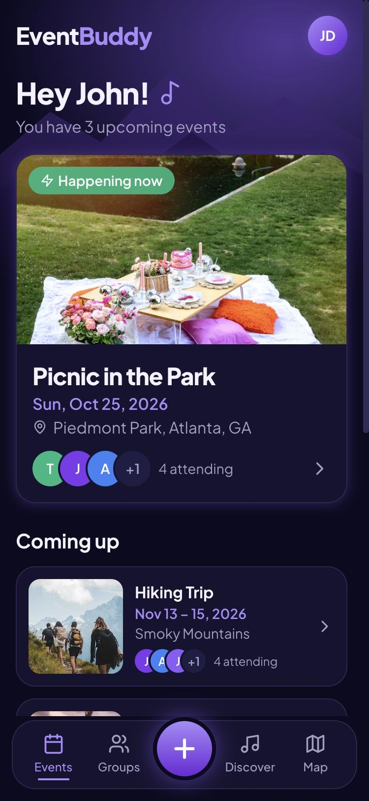
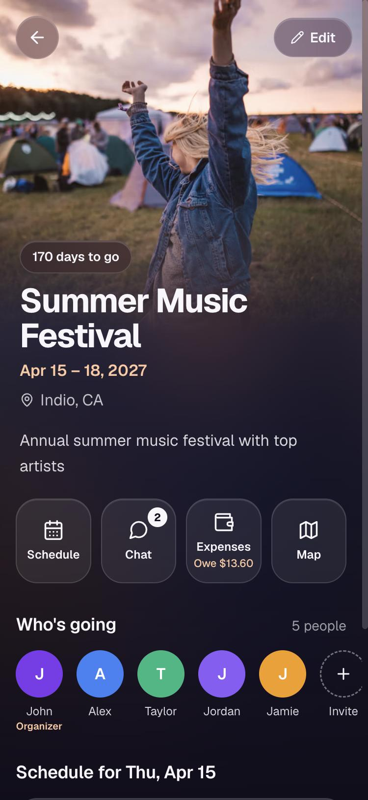
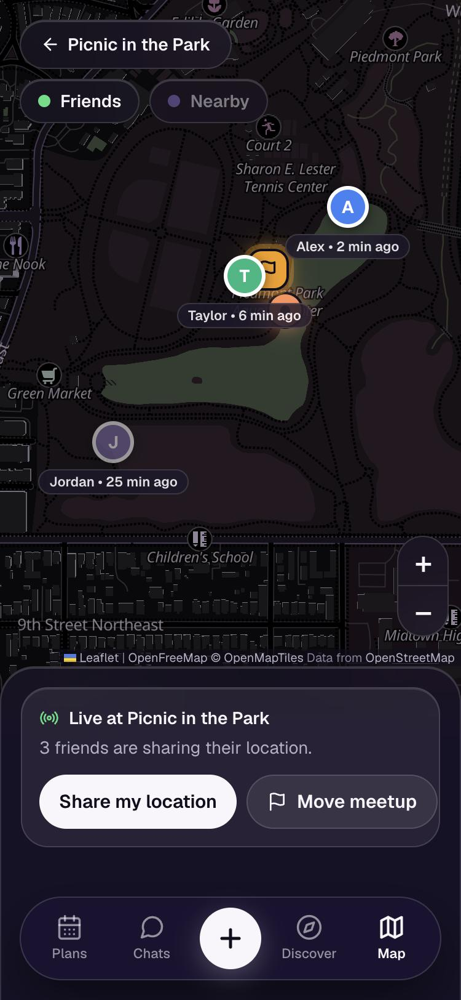
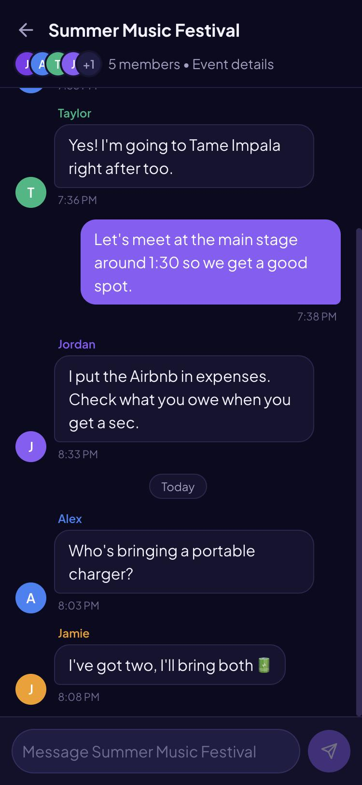
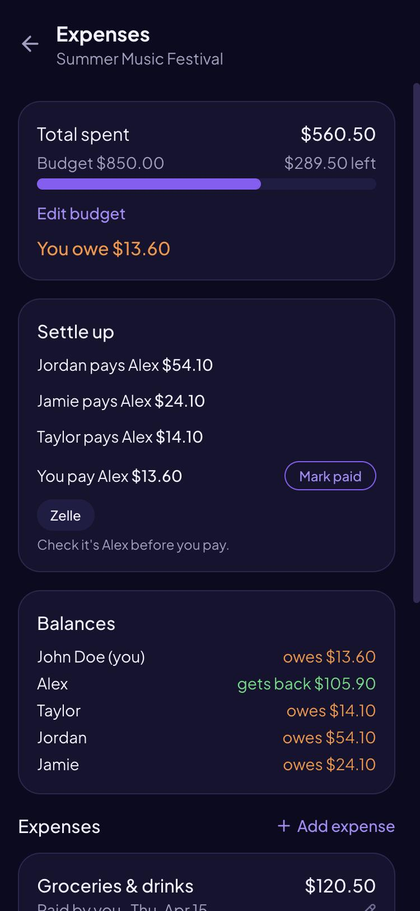
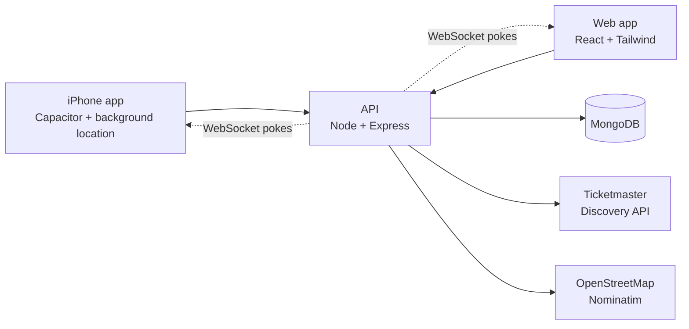

# EventBuddy

A phone app for planning trips, festivals and nights out with friends: one place for the schedule, the group chat, who owes whom, and where everyone is once you get there.

Built end to end by me: React front end, Express and MongoDB API, and a native iPhone app (Capacitor) that keeps sharing your location with your friends while the phone is locked.

**[Try the live demo](https://eventbuddy-exic.onrender.com)** and tap **Try the demo** to look around as John, in your own copy of the demo, so change anything you like. It runs on a free server that sleeps when idle, so the first visit can take up to a minute to wake it.

| Home | Event | Live map | Group chat | Split costs |
|---|---|---|---|---|
|  |  |  |  |  |

## What it does

- **Plan together.** Single or multi-day events, a shared schedule with who's going to what, and invite links that let friends join in one tap.
- **Talk in one place.** Every event has its own group chat, with unread counts on the Groups tab and new messages arriving the moment they're sent.
- **See who's here.** A green dot on a friend's avatar, a "Here now" line in the chat and on the map mean they have EventBuddy open right now.
- **Split costs.** Add expenses split equally or by exact amounts. EventBuddy works out balances and a short list of payments to settle up, then opens Venmo, Cash App or PayPal with the amount filled in. The money moves in those apps; EventBuddy only records what you mark paid. Amounts are US dollars, and schedule times are local to the event.
- **Find each other.** During an event, friends can share their location for an hour, a few hours or until midnight. The map shows where everyone is, how recently they updated, and a meetup point anyone can set. In the iPhone app, sharing keeps working with the screen locked. Before the trip, an event's map helps plan it instead: directions, a meetup point for the first day, and what else is on nearby during those dates.
- **Discover things to do.** Concerts, games and shows near you (Ticketmaster), found from your phone's location without setting anything up, each one a tap away from becoming a plan with friends.

## Run it locally

You need Node.js 22 (`nvm use` picks it up from `.nvmrc`).

```bash
git clone https://github.com/Wrd123/EventBuddy.git
cd EventBuddy
npm install
npm --prefix server install
npm run dev
```

Open http://localhost:3000 and tap **Try the demo**. With no database configured, the API runs in demo mode: an in-memory MongoDB loaded with a demo world (a picnic happening today with friends sharing their location, a festival with a busy chat and shared costs), fresh on every restart.

Optional: Discover needs a free [Ticketmaster API key](https://developer.ticketmaster.com/) in `server/.env` as `TICKETMASTER_API_KEY`. Everything else works without one.

### The iPhone app

With Xcode installed:

```bash
npm run ios
```

This builds the web app, copies it into the native project and opens it in Xcode; run it on a simulator. To try sharing with the screen locked in the Simulator, use **Features > Location** to set or animate a location, then lock the device.

### Hosting the demo for free

[`render.yaml`](render.yaml) puts the demo on Render's free plan: the web app as a static site, and the API as a free web service in demo mode. There's no database to pay for or look after: the API keeps everything in memory, and every visitor who taps **Try the demo** gets a private copy of the demo data.

1. In Render, choose **New > Blueprint** and pick this repository.
2. When it asks, enter the two addresses (and optionally a Ticketmaster key):
   - `CLIENT_ORIGIN`: `https://eventbuddy.onrender.com`
   - `REACT_APP_API_URL`: `https://eventbuddy-api.onrender.com/api`
3. If Render gave a service a different address because the name was taken, correct these under each service's **Environment**, then redeploy the web app so its build picks up the change.

The web app is served with a strict Content Security Policy (the `headers` in `render.yaml`): it runs only its own scripts, and talks only to the API on `onrender.com` and the map's tile server. If your API lives anywhere else, add its address to `connect-src`. To try a build under exactly those headers before deploying, build it, then serve it with `node scripts/serve-build.js --api http://localhost:4000`.

The free API sleeps after 15 idle minutes and takes up to a minute to start. Meanwhile, the web app shows a "Waking up the demo" screen and opens as soon as the API answers.

The iPhone app can use the hosted demo too. Give it both addresses of the same deployment: the API it talks to, and the web app that invite links open (an invite joins through that web app's API, so the two have to match). The build stops if either is missing or isn't `https`:

```bash
EVENTBUDDY_API_URL=https://eventbuddy-api.onrender.com/api EVENTBUDDY_PUBLIC_URL=https://eventbuddy.onrender.com npm run build:ios
```

Without them, `npm run build:ios` builds against the API on your Mac, and its invite links only work there.

## How it's built



| Layer | Technologies |
|---|---|
| App | React 18, React Router, Tailwind CSS, Leaflet with MapLibre vector tiles from OpenFreeMap (free, keyless) |
| iPhone | Capacitor 7, background geolocation, native HTTP, haptics |
| API | Node.js 22, Express 5, MongoDB with Mongoose, JWT auth, bcrypt, `ws` for real-time pokes |
| Testing | Jest and Testing Library (468 tests), Node's test runner with Supertest, a real WebSocket client and an in-memory MongoDB (360 tests) |
| CI | GitHub Actions: tests and a production build on every push |

## Decisions worth a look

- **Money is stored in whole cents.** Dollars in floating point drift (0.1 + 0.2 isn't 0.3), and an equal split of $100 between three people has to add up to exactly $100. Settling up uses a greedy match of the largest debtor with the largest creditor, which keeps the number of payments small.
- **Chat pages by message id, not timestamp.** MongoDB ids increase over time, so "everything after this id" never skips or repeats a message, even when two arrive in the same second.
- **Real time is a poke, not a payload.** When something changes, the server sends the event's members a WebSocket message that only says what changed (`chat`, `live`, the `event`), and the app runs the same read it would have polled with. All the work that keeps late or overlapping answers from undoing newer ones stays in one place, a slip in the socket's access checks could reveal at most that something changed, and without a socket (offline, a blocking proxy, an older app) polling carries on as before. While connected, polling slows to a once-a-minute safety net; it only runs while the app is on screen, and so does the socket. The socket logs in with its first message rather than the URL, so tokens stay out of logs. Its subscriptions are tracked in the server's memory, which suits the single free instance; a second instance would need pub/sub such as Redis to pass pokes between them.
- **Here now is just an open socket.** The socket only exists while the app is on screen, so having one is what being here means; there's no separate heartbeat or "last seen" to store. The server sends each event's members the ids of the others who are connected, never to anyone outside the event, and waits 5 seconds before letting someone go, so switching apps for a moment doesn't flash them away.
- **Read receipts are deliberately absent.** How far you've read is stored apart from the event's member list, which every member receives, so unread counts work without telling the group what you've read.
- **Location sharing is built to forget.** It's opt-in per event, lasts at most 24 hours and only while the event is on. The server keeps only your latest position, and a MongoDB TTL index deletes it when sharing ends; reads also filter on the end time, since TTL cleanup runs about once a minute. A map opened from an event only ever shows that event's members, and only while it's on.
- **Background location is one small seam.** A single tracker module uses the native background plugin in the app and the browser's geolocation on the web, and app-wide sharing state keeps it running on every screen, through a relaunch, and stops it on logout.
- **Third-party APIs stay behind the server.** API keys never ship to the phone, results are cached (30 minutes for events, a day for places), OpenStreetMap's one-request-per-second rule is enforced with a queue, and user coordinates are rounded to about 1 km before they leave the phone for Discover.
- **The map updates pins in place.** Friends' positions refresh every 10 seconds; markers are matched by id and moved rather than redrawn, so labels don't flicker. Debugging the first version turned up that Leaflet silently ignores a new view while a zoom animation is running, so automatic fits are instant.
- **Cover photos without photo storage or choosing.** Each event type has 10 hand-picked free [Unsplash](https://unsplash.com) photos, served by Unsplash's image CDN at the size each screen draws them. Nobody picks one: each organizer's events of a type take the photos in turn (your first concert gets concert photo 1, your second photo 2), so a list of plans never repeats a picture until the 11th. The server assigns the number and the app owns the photo list, so there's nothing to upload, store or pay for. If a photo can't load, an illustrated cover drawn in SVG stands in.
- **Taps answer at once, and the server still gets the last word.** Marking a payment paid or tapping Going changes the screen before the server replies. A payment carries an id the app made, so a retry after a lost reply can't be saved twice, and a poll that lands mid-request can't erase it or count it double. Going sends at most one request per plan at a time, and the last one always carries your final tap, because a server can apply two quick requests in either order. If the server says no, the change is undone with a short reason.
- **One bottom sheet for every dialog.** Each sheet traps focus, closes on Escape or a downward drag, switches the screen behind it off for screen readers and taps, and gives focus back to whatever opened it. Screens slide in like a native stack, and every animation respects Reduce Motion.
- **Demo mode instead of production infrastructure.** For a showcase, an in-memory database is cheaper and safer than a real one: no stored personal data and nothing to clean up.
- **Every demo visitor gets a private world.** Tapping **Try the demo** creates a fresh copy of John, his friends, their events, chat and costs, so nothing one visitor adds shows up for the next. Every id in a world is derived from a random tag carried in the login token, so when the free server sleeps and wakes with an empty database, a saved login rebuilds the same world. Worlds expire after a day and at most 300 are kept, which bounds memory no matter how often someone taps the button. The picnic is placed on the visitor's own date, so it's happening "today" in any time zone, with an afternoon planned, a little to settle up and friends already on the map.

## Project structure

```
EventBuddy/
├── src/                     # React app
│   ├── components/
│   │   ├── screens/         # One per route, with their tests
│   │   ├── map/             # Leaflet wrapper and live-location panels
│   │   ├── common/          # Shared components
│   │   └── layout/          # Routing, tab bar, laptop showcase frame
│   ├── context/             # Auth/events state and app-wide location sharing
│   ├── hooks/               # Data hooks (chat, live locations, map, places)
│   ├── services/            # API calls, the real-time socket and the location tracker
│   └── utils/               # Dates, money, ledger, chat and map helpers
├── server/                  # Express API
│   ├── src/
│   │   ├── routes/          # auth, events, schedule, expenses, messages, live, map, discover
│   │   ├── models/          # Mongoose models
│   │   ├── realtime/        # WebSocket hub: who's subscribed to what, and the pokes
│   │   ├── discover/        # Ticketmaster and OpenStreetMap clients with caching
│   │   └── seed/            # Demo data
│   └── tests/               # API tests
├── ios/                     # Native iPhone project (Capacitor)
├── docs/screenshots/        # README screenshots
├── resources/               # Icon source
├── render.yaml              # Free hosted demo (Render Blueprint)
└── .github/workflows/       # CI
```

## Scripts

| Command | What it does |
|---|---|
| `npm run dev` | App and API together |
| `npm test` | App tests |
| `npm run test:server` | API tests |
| `npm run build` | Production build of the app |
| `npm run ios` | Build and open the iPhone app in Xcode |
| `npm run build:ios` | Build for iOS against `EVENTBUDDY_API_URL` (default: the local API) |

## License

[MIT](LICENSE)

Event cover photos are from [Unsplash](https://unsplash.com) and used under the [Unsplash License](https://unsplash.com/license).
