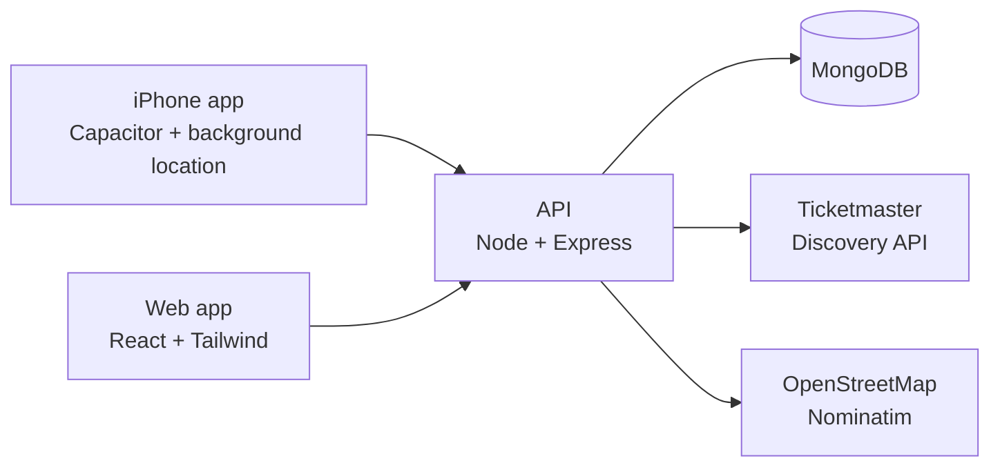

# EventBuddy

A phone app for planning trips, festivals and nights out with friends: one place for the schedule, the group chat, who owes whom, and where everyone is once you get there.

Built end to end by me: React front end, Express and MongoDB API, and a native iPhone app (Capacitor) that keeps sharing your location with your friends while the phone is locked.

**[Try the live demo](https://eventbuddy-exic.onrender.com)** and tap **Try the demo** to look around as John. It runs on a free server that sleeps when idle, so the first visit can take up to a minute to wake it.

## What it does

- **Plan together.** Single or multi-day events, a shared schedule with who's going to what, and invite links that let friends join in one tap.
- **Talk in one place.** Every event has its own group chat, with unread counts on the Groups tab and new messages arriving while it's open.
- **Split costs.** Add expenses split equally or by exact amounts. EventBuddy works out balances and the fewest payments to settle up, then opens Venmo, Cash App or PayPal with the amount filled in.
- **Find each other.** During an event, friends can share their location for an hour, a few hours or until midnight. The map shows where everyone is, how recently they updated, and a meetup point anyone can set. In the iPhone app, sharing keeps working with the screen locked.
- **Discover things to do.** Concerts, games and shows near you (Ticketmaster), each one a tap away from becoming a plan with friends.

## Run it locally

You need Node.js 22 (`nvm use` picks it up from `.nvmrc`).

```bash
git clone https://github.com/Wrd123/EventBuddy.git
cd EventBuddy
npm install
npm --prefix server install
npm run dev
```

Open http://localhost:3000 and tap **Try the demo**. With no database configured, the API runs in demo mode: an in-memory MongoDB loaded with a demo world (a picnic happening today with friends sharing their location, a festival with a busy chat and shared costs), fresh on every restart.

Optional: Discover needs a free [Ticketmaster API key](https://developer.ticketmaster.com/) in `server/.env` as `TICKETMASTER_API_KEY`. Everything else works without one.

### The iPhone app

With Xcode installed:

```bash
npm run ios
```

This builds the web app, copies it into the native project and opens it in Xcode; run it on a simulator. To try sharing with the screen locked in the Simulator, use **Features > Location** to set or animate a location, then lock the device.

### Hosting the demo for free

[`render.yaml`](render.yaml) puts the demo on Render's free plan: the web app as a static site, and the API as a free web service in demo mode. There's no database to pay for or look after; the API's in-memory database starts fresh from the demo data each time it wakes.

1. In Render, choose **New > Blueprint** and pick this repository.
2. When it asks, enter the two addresses (and optionally a Ticketmaster key):
   - `CLIENT_ORIGIN`: `https://eventbuddy.onrender.com`
   - `REACT_APP_API_URL`: `https://eventbuddy-api.onrender.com/api`
3. If Render gave a service a different address because the name was taken, correct these under each service's **Environment**, then redeploy the web app so its build picks up the change.

The free API sleeps after 15 idle minutes and takes up to a minute to start. Meanwhile, the web app shows a "Waking up the demo" screen and opens as soon as the API answers.

The iPhone app can use the hosted API too:

```bash
EVENTBUDDY_API_URL=https://eventbuddy-api.onrender.com/api npm run build:ios
```

## How it's built



| Layer | Technologies |
|---|---|
| App | React 18, React Router, Tailwind CSS, Leaflet |
| iPhone | Capacitor 7, background geolocation, native HTTP |
| API | Node.js 22, Express 5, MongoDB with Mongoose, JWT auth, bcrypt |
| Testing | Jest and Testing Library (231 tests), Node's test runner with Supertest and an in-memory MongoDB (244 tests) |
| CI | GitHub Actions: tests and a production build on every push |

## Decisions worth a look

- **Money is stored in whole cents.** Dollars in floating point drift (0.1 + 0.2 isn't 0.3), and an equal split of $100 between three people has to add up to exactly $100. Settling up uses a greedy match of the largest debtor with the largest creditor, which keeps the number of payments small.
- **Chat pages by message id, not timestamp.** MongoDB ids increase over time, so "everything after this id" never skips or repeats a message, even when two arrive in the same second. The app polls every 4 seconds only while it's on screen.
- **Read receipts are deliberately absent.** How far you've read is stored apart from the event's member list, which every member receives, so unread counts work without telling the group what you've read.
- **Location sharing is built to forget.** It's opt-in per event, lasts at most 24 hours and only while the event is on. The server keeps only your latest position, and a MongoDB TTL index deletes it when sharing ends; reads also filter on the end time, since TTL cleanup runs about once a minute.
- **Background location is one small seam.** A single tracker module uses the native background plugin in the app and the browser's geolocation on the web, and app-wide sharing state keeps it running on every screen, through a relaunch, and stops it on logout.
- **Third-party APIs stay behind the server.** API keys never ship to the phone, results are cached (30 minutes for events, a day for places), OpenStreetMap's one-request-per-second rule is enforced with a queue, and user coordinates are rounded to about 1 km before they leave the phone for Discover.
- **The map updates pins in place.** Friends' positions refresh every 10 seconds; markers are matched by id and moved rather than redrawn, so labels don't flicker. Debugging the first version turned up that Leaflet silently ignores a new view while a zoom animation is running, so automatic fits are instant.
- **Demo mode instead of production infrastructure.** For a showcase, a fresh in-memory database seeded on every start is cheaper and safer than a real one: no stored personal data, nothing to clean up, and every visitor sees the same lively demo. Demo accounts keep fixed ids, so a saved login still works after the server sleeps and wakes with a new database.

## Project structure

```
EventBuddy/
├── src/                     # React app
│   ├── components/
│   │   ├── screens/         # One per route, with their tests
│   │   ├── map/             # Leaflet wrapper and live-location panels
│   │   ├── common/          # Shared components
│   │   └── layout/          # Routing, tab bar, laptop showcase frame
│   ├── context/             # Auth/events state and app-wide location sharing
│   ├── hooks/               # Data hooks (chat, live locations, map, places)
│   ├── services/            # API calls and the location tracker
│   └── utils/               # Dates, money, ledger, chat and map helpers
├── server/                  # Express API
│   ├── src/
│   │   ├── routes/          # auth, events, schedule, expenses, messages, live, map, discover
│   │   ├── models/          # Mongoose models
│   │   ├── discover/        # Ticketmaster and OpenStreetMap clients with caching
│   │   └── seed/            # Demo data
│   └── tests/               # API tests
├── ios/                     # Native iPhone project (Capacitor)
├── resources/               # Icon source
├── render.yaml              # Free hosted demo (Render Blueprint)
└── .github/workflows/       # CI
```

## Scripts

| Command | What it does |
|---|---|
| `npm run dev` | App and API together |
| `npm test` | App tests |
| `npm run test:server` | API tests |
| `npm run build` | Production build of the app |
| `npm run ios` | Build and open the iPhone app in Xcode |
| `npm run build:ios` | Build for iOS against `EVENTBUDDY_API_URL` (default: the local API) |
